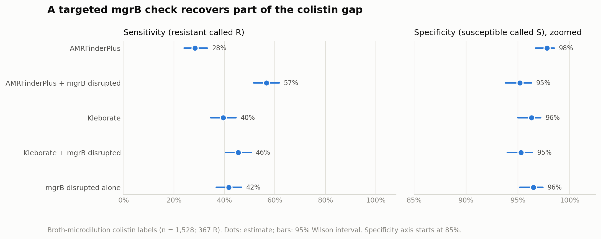
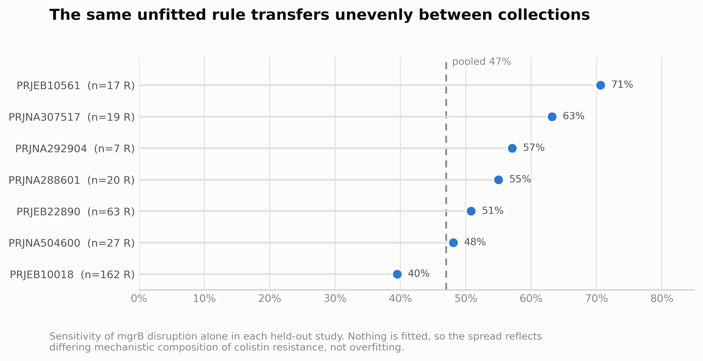
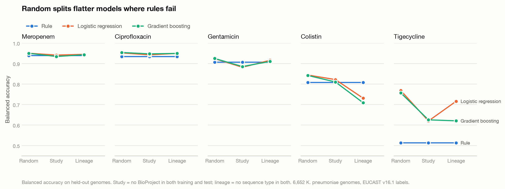

# Why genomic prediction of colistin resistance does not transfer between *Klebsiella pneumoniae* collections

Md Omar Faruqe

Montréal, Québec, Canada. Correspondence: faruqe.cse@gmail.com

Code and data: https://github.com/omarfaruqe/klebsiella-amr

---

## Abstract

**Background.** Genomic prediction of antimicrobial susceptibility is accurate for drugs whose
resistance is conferred by acquired genes, but poor for colistin, where resistance in
*K. pneumoniae* arises largely from loss of the chromosomal regulator *mgrB*. Why it is poor, and
whether machine learning closes the gap, has not been examined at the level of individual
mechanisms.

**Methods.** We assembled 6,652 public *K. pneumoniae* genomes from BV-BRC passing assembly
quality control and carrying laboratory susceptibility results, and re-interpreted every minimum
inhibitory concentration (MIC) under a single standard (EUCAST v16.1). Genotypes were called with
AMRFinderPlus 4.2.7 and Kleborate 3.2.4. We added a targeted *mgrB* integrity check — tblastn of
the reference MgrB protein against each assembly, classifying the locus as intact, missense, or
disrupted — and benchmarked rule-based prediction against logistic regression and gradient
boosting under random, study-aware (BioProject-grouped), lineage-aware (sequence-type-grouped)
and temporal splits, with paired bootstrap comparisons.

**Results.** Among 1,528 genomes with broth-microdilution colistin labels (367 resistant), *mgrB*
was disrupted in 153 resistant versus 41 susceptible genomes. Adding mechanism-specified *mgrB*
disruption raised colistin sensitivity from 28.3% (95% CI 24.0–33.2) to 56.7% (51.6–61.7) for
AMRFinderPlus and from 39.5% (34.6–44.6) to 45.5% (40.5–50.6) for Kleborate, which already calls
MgrB truncations. The association was not an artefact of assembly fragmentation: within the
quartile of least fragmented assemblies, 81% of *mgrB*-disrupted genomes were resistant against
4% of intact ones, and the gap persisted across all quartiles. The breaks carried
insertion-sequence signatures: they lay a median of 79 bp from *mgrB* against 80,470 bp in
genomes with intact *mgrB*, the adjacent sequence was multi-copy within its own assembly more
often than length-matched control contig ends (72% versus 35% with three or more copies), and 98%
of these sequences recurred in unrelated isolates. Crucially, leave-one-study-out
analysis showed sensitivity of this unfitted rule ranging from 39.5% to 70.6% between
collections; in the largest single study *mgrB* disruption accounted for under 40% of colistin
resistance. A second tier based on *mgrB* missense variants appeared to add 19.1 points of
sensitivity in-sample but 0.9 points when variants were selected out-of-sample, and was
discarded. Against machine learning, the ordering inverted with validation stringency: models
exceeded the rule under random splitting (balanced accuracy 0.844 and 0.842 versus 0.759; paired
differences −0.085 and −0.083, both excluding zero) and under study-aware splitting, but fell
below it under lineage-aware splitting (0.731 and 0.709 versus 0.759; +0.028, 95% CI +0.002 to
+0.052, and +0.050, +0.026 to +0.075). The margin over logistic regression is marginal, that over
gradient boosting clearer. A predictor using sequence type alone reached 0.737 for meropenem but
only 0.554 for colistin, and study-aware and lineage-aware splits each left the other
dimension 74–95% overlapping.

**Conclusions.** The apparent superiority of machine learning for colistin reverses when
lineages are held out. It is not explained by lineage labels themselves: a sequence-type-only
predictor reached just 0.554, so what the models lose is a finer-grained resemblance between
related isolates.
More fundamentally, the mechanistic composition of colistin resistance differs substantially
between public genome collections, so neither rules nor models transfer reliably — a limit that
random and even study-aware validation conceals. We recommend that genomic AMR evaluations report
a mechanism-specified rule baseline, harmonise breakpoints explicitly, and use lineage-aware
splits.

**Keywords:** antimicrobial resistance, *Klebsiella pneumoniae*, colistin, *mgrB*, genomic
prediction, external validity, data leakage

---

## 1. Introduction

For most drug–organism combinations in *Klebsiella pneumoniae*, resistance is conferred by
acquired genes or well-characterised target mutations, and tools such as AMRFinderPlus and
Kleborate detect them reliably. Colistin is the conspicuous exception, and the exception matters:
colistin is a last-line agent against carbapenem-resistant *K. pneumoniae*, and resistance arises
predominantly not from an acquired gene but from loss of function of *mgrB*, a 47-codon
chromosomal gene encoding a negative regulator of the PhoPQ two-component system. Loss of MgrB
de-represses PhoPQ, modifying lipid A and reducing colistin binding.

The commonest route to *mgrB* loss is insertion-sequence (IS) transposition into the gene, which
creates a specific detection problem. An IS element inserted into a 144-base-pair coding sequence
is typically longer than the repeat a short-read assembler can resolve, so the assembly breaks
inside *mgrB*. A gene-presence screen finds no acquired colistin determinant; a point-mutation
screen finds no codon change, because the alignment simply ends. The genome appears wild type at
the one locus that matters.

Two further issues complicate measuring how well genotype predicts phenotype on public data.
Deposited labels mix interpretive standards, so identical MICs can be reported susceptible under
one CLSI revision and resistant under EUCAST, introducing systematic noise easily mistaken for
genotype error. And public collections are dominated by outbreak investigations and surveys of
high-risk clones, so closely related isolates are abundant and random train/test splitting places
near-identical genomes on both sides. Yu and colleagues recently demonstrated across more than
24,000 genomes from five species that models trained this way substantially conflate lineage
markers with resistance determinants, and recommended comparison against rule-based baselines as
future work [1].

We take that recommendation as the design principle and ask a mechanism-level question: when a
resistance determinant is detectable but routinely missed, does supplying it to a rule outperform
letting a model find it, and does either transfer to new collections? We assemble a 6,652-genome
cohort with harmonised labels, add a targeted *mgrB* check designed around the assembly-break
failure mode, and evaluate rules and models under progressively stricter validation.

---

## 2. Methods

### 2.1 Cohort assembly and provenance

All *K. pneumoniae* (taxon 573) AMR phenotype records were downloaded from the BV-BRC `genome_amr`
endpoint (snapshot 2026-10-22; 1,840,793 records, 39,598 genomes). Retrieval re-run the following
day reproduced byte-identical output (SHA-256 d0e561a6…1505126). Every data pull writes a manifest
recording query, timestamp, record count and checksum.

Only records with `evidence = "Laboratory Method"` were used as labels (85,291 records, 7,276
genomes); computational predictions deposited in the same database were excluded as circular.

### 2.2 Label harmonisation

Labels follow EUCAST Clinical Breakpoint Tables v16.1 [2]. Each record carrying an MIC was
re-interpreted (S if MIC ≤ s_le, R if MIC > r_gt, else I) rather than accepting the deposited
call. Censored measurements that cannot be resolved against the breakpoint yield no label.

This recovered substantial data: records deposited without an S/I/R call were uninterpreted
measurements rather than missing data, and re-interpretation added 1,921 labelled genomes for
meropenem, 959 for ciprofloxacin, 598 for colistin and 560 for gentamicin. It also resolved most
apparent contradictions — meropenem label conflicts fell from 60 genomes to 8 — because the
majority were the same genome interpreted under different standards by different studies. Where
both a deposited and a re-interpreted call existed they agreed in 92.9–97.2% of records.

Three policies were fixed in advance and recorded as decision records in the repository:
intermediate and conflicting labels are excluded; colistin labels are restricted to broth
microdilution, the only method EUCAST accepts for colistin MICs; and study-level label sets judged
implausible on review are flagged and excluded with evidence recorded (one flag applied, §3.9).
Tigecycline has no EUCAST breakpoint for *K. pneumoniae*, so deposited calls were used.

### 2.3 Assembly quality control and genotyping

Assemblies were required to be *K. pneumoniae* by both species field and genome name, 5.0–6.5 Mb,
≤500 contigs, N50 ≥20 kb, CheckM completeness ≥95% and contamination ≤5%. Of 6,817 labelled
genomes 6,652 passed. Requiring agreement between species field and genome name removed four
genomes with internally inconsistent BV-BRC records, one independently confirmed as *Citrobacter
freundii*.

Assemblies were downloaded from BV-BRC by genome identifier — 63% of QC-passing genomes
(4,190/6,652) have no NCBI assembly accession — and validated for format and length. AMRFinderPlus
4.2.7 (database 2026-08-07.1) was run in nucleotide mode with `--organism Klebsiella_pneumoniae
--plus`, and Kleborate 3.2.4 with Kaptive 3.2.2 using the `kpsc` preset. All 6,652 genomes
completed both tools (8.8 h wall time, ~140 CPU-hours, zero failures). A cross-machine
verification script reproduces identical calls on macOS arm64 and Ubuntu x86_64.

### 2.4 Rule-based prediction

Per-drug rules were specified from tool output before phenotype comparison: acquired carbapenemase
for meropenem; QRDR mutation or acquired quinolone gene for ciprofloxacin; aminoglycoside-modifying
enzyme or 16S rRNA methyltransferase for gentamicin; *mcr* or *mgrB*/*pmrAB*/*phoPQ* determinants
for colistin; acquired *tet(X)* or *tmexCD-toprJ* for tigecycline.

Two corrections were applied after a 524-genome pilot, both tool-annotation artefacts rather than
biology. AMRFinderPlus assigns the intrinsic chromosomal *oqxAB* pump to tigecycline as well as
quinolones; since essentially all *K. pneumoniae* carry *oqxAB* this produced 88 of 91 pilot
tigecycline false positives, and *oqxAB* is now excluded for all drugs. Efflux-regulator variants
(*oqxR*, *ramR*, *acrR*) produced 21 of 26 pilot ciprofloxacin false positives and are reported as
a separate tier rather than folded into the core rule.

### 2.5 Targeted *mgrB* integrity check

The MgrB reference protein (WP_002911375.1, 47 aa) was searched against each assembly with tblastn
(e-value ≤1e-5, hits ≥10 aa) and the best hit classified as **intact** (full-length, no residue
differences); **missense** (full-length with substitutions); **premature_stop**;
**frameshift_or_indel** (two fragments on one contig <300 bp apart); **insertion_assembled** (two
fragments >300 bp apart); **split_contigs**; **contig_break** (alignment terminating at a contig
edge); **partial**; or **absent**. All categories except intact and missense count as disrupted.
The `split_contigs`, `contig_break` and `partial` categories are the assembly signature described
in §1. The search takes 2 minutes for 6,652 assemblies on 16 threads.

Residue differences are enumerated by direct comparison of aligned sequences, ignoring query
position 1, because tblastn translates alternative start codons (GTG, TTG) as V or L rather than
M. An initial implementation using percentage identity classified 6,048 genomes as missense at
exactly 97.9% identity — a single artefactual mismatch at the start codon.

### 2.6 Testing the insertion-sequence interpretation

The `split_contigs`, `contig_break` and `partial` categories are inferences from assembly
structure, so we tested three predictions that follow from IS insertion but not from incidental
fragmentation. First, position: the break should coincide with *mgrB*, compared against genomes
with intact *mgrB*. Second, repetitiveness: sequence at the *mgrB*-adjacent contig end should have
copies elsewhere in the same assembly. Because contig ends are repeat-enriched in general, this was
compared against randomly chosen other contig ends in the same assemblies, truncated to the same
length as each genome's *mgrB* flank. Third, recurrence: the same sequences should appear at *mgrB*
in unrelated isolates. Flanks were taken as up to 600 bp of contig end adjacent to *mgrB* (minimum
50 bp) and compared by blastn at ≥95% identity (within genome) or ≥90% (between genomes) over ≥80%
of the flank.

### 2.7 Validating the *mgrB* rule

Because three disruption categories are inferred from assembly structure, we tested whether the
association with phenotype could reflect assembly fragmentation by comparing contig counts and N50
between calls, and by stratifying the colistin association on assembly-quality quartile.

Because the decision to treat missense variants as resistance-predicting was made after observing
their enrichment in this cohort, we re-estimated that tier by leave-one-study-out: variants were
selected on training studies only (≥3 genomes, >50% resistant) and applied to the held-out study.
The disruption tier, being mechanism-specified and fitted to nothing, was evaluated in the same
framework for comparison.

### 2.8 Attributing performance to lineage

To test directly, rather than infer, how much performance is obtainable from lineage, we built a
predictor using sequence type alone: for each test genome it returns the majority label of that
genome's sequence type among training genomes, falling back to the overall training majority when
the type is unseen. It uses no resistance determinant. We also measured, for each split scheme,
the fraction of test genomes sharing a sequence type or a BioProject with any training genome.

### 2.9 Benchmark

Features were 226 binary indicators per genome: AMRFinderPlus gene families (allele suffixes
collapsed, OXA-48-like kept distinct from other OXA enzymes), 100 point-mutation calls, 33
AMRFinderPlus functional subclasses, and two *mgrB* features. Features present in fewer than five
genomes were dropped.

Three predictors were compared: the per-drug rule (for colistin including mechanism-specified
*mgrB* disruption, but not the missense tier, for the reason given in §3.4); L2 logistic regression
(C = 1, class-balanced); and gradient boosting (HistGradientBoostingClassifier, 200 iterations, 15
leaves, class-balanced). Hyperparameters were fixed rather than tuned, since the object of study is
validation design rather than peak performance.

Four split schemes were used: random 5-fold; study-aware 5-fold grouped by BioProject;
lineage-aware 5-fold grouped by sequence type; and temporal. Genomes with missing group metadata
were assigned singleton groups so absent metadata can never merge unrelated isolates. Metrics are
computed on pooled held-out predictions with 95% Wilson intervals, reported both on all test labels
and with borderline-MIC labels removed. A split is scored only if its test set contains at least 10
resistant and 10 susceptible genomes. Differences between predictors were assessed by paired
bootstrap over held-out genomes (2,000 resamples), resampling once per iteration and recomputing
both predictors on the same resampled set.

### 2.10 Reproducibility

All analyses are deterministic for a fixed seed (20261024). Code, pinned environments, manifests,
decision records, reports and figures are at https://github.com/omarfaruqe/klebsiella-amr.

---

## 3. Results

### 3.1 Cohort

The cohort comprised 6,652 QC-passing genomes with harmonised labels: meropenem 5,541 (1,854 R /
3,687 S), ciprofloxacin 4,640 (3,441 / 1,199), gentamicin 4,760 (2,113 / 2,647), colistin 1,528
broth-microdilution (367 / 1,161), tigecycline 948 (261 / 687). It is structurally non-random, as
expected: two BioProjects contribute 44% of genomes, the ten commonest sequence types account for
52%, and collection year is missing for 34% (2,266/6,652).

### 3.2 Known mechanisms explain four drugs well and colistin poorly

| Drug | AMRFinderPlus sensitivity | specificity | Kleborate sensitivity | specificity |
|---|---|---|---|---|
| Ciprofloxacin | 98.8% (98.4–99.1) | 88.2% | 98.7% | 88.4% |
| Meropenem | 96.7% (95.7–97.4) | 91.2% | 96.5% | 91.3% |
| Gentamicin | 85.1% (83.6–86.6) | 94.9% | 81.4% | 95.8% |
| **Colistin** | **28.3% (24.0–33.2)** | 97.8% | **39.5% (34.6–44.6)** | 96.3% |
| **Tigecycline** | **2.7% (1.3–5.4)** | 100.0% | **0.0%** | 100.0% |

The tools agree on 97.8–99.9% of genome–drug pairs for every drug except colistin (87.8%), the one
drug where they differ in what they look for: Kleborate's higher sensitivity derives from MgrB
truncation calls that AMRFinderPlus's point-mutation screen does not make. For colistin, 263 of 367
resistant genomes carried no AMRFinderPlus determinant at all.

### 3.3 A targeted *mgrB* check recovers part of the gap

Across all 6,652 genomes *mgrB* was intact in 6,056, missense in 129, and disrupted in 467, the
last dominated by the assembly signatures predicted in §1: split across contigs (162), partial
(153), premature stop (73), absent (34), frameshift or indel (27), contig break (13) and assembled
internal insertion (5).

Among the 1,528 genomes with broth-microdilution labels (24% resistant overall):

| *mgrB* status | Resistant | Susceptible |
|---|---|---|
| Disrupted | 153 | 41 |
| Missense | 70 | 13 |
| Intact | 144 | 1,107 |

Adding mechanism-specified disruption to the rules (Figure 1):

| Rule | Sensitivity (95% CI) | Specificity (95% CI) |
|---|---|---|
| AMRFinderPlus | 28.3% (24.0–33.2) | 97.8% (96.7–98.5) |
| **AMRFinderPlus + *mgrB* disrupted** | **56.7% (51.6–61.7)** | **95.2% (93.8–96.3)** |
| Kleborate | 39.5% (34.6–44.6) | 96.3% (95.0–97.2) |
| **Kleborate + *mgrB* disrupted** | **45.5% (40.5–50.6)** | **95.3% (94.0–96.4)** |
| *mgrB* disrupted alone | 41.7% (36.8–46.8) | 96.5% (95.2–97.4) |

**Figure 1.** Colistin sensitivity and specificity for each rule, with and without the targeted
*mgrB* disruption check. Dots are point estimates, bars 95% Wilson intervals; broth-microdilution
labels (n = 1,528; 367 resistant). The specificity axis begins at 85%.

The increment is large against AMRFinderPlus (+28.4 points) and modest against Kleborate (+6.0
points), which already detects MgrB truncation by sequence coverage. Kleborate is the appropriate
comparator for the state of the art, and the honest gain is therefore six points. Notably, the
*mgrB* check used alone, with no gene screen, slightly exceeds Kleborate alone.

**The association is not an assembly artefact.** Median contig counts were similar between calls
(disrupted 116, intact 104, missense 108), and stratifying on assembly quality left the association
intact:

| Contig quartile | *mgrB* intact, % resistant | *mgrB* disrupted, % resistant |
|---|---|---|
| Q1 (fewest contigs) | 4% (n=337) | 81% (n=32) |
| Q2 | 8% (n=315) | 69% (n=48) |
| Q3 | 17% (n=292) | 83% (n=65) |
| Q4 (most contigs) | 18% (n=307) | 82% (n=49) |

The gap is widest, not narrowest, among the least fragmented assemblies. Disruption calls inferred
from assembly structure behaved similarly to sequence-level calls (76% versus 86% resistant,
against 12% for intact *mgrB*), indicating that the assembly-break categories carry genuine signal.

### 3.4 The contig breaks carry insertion-sequence signatures

Among the 328 genomes whose *mgrB* disruption was inferred from assembly structure, the break
coincided with the gene: median distance from the *mgrB* fragment to the contig end was 79 bp, with
63% within 100 bp and 87% within 1 kb. In 328 matched genomes with intact *mgrB*, the gene lay a
median of 80,470 bp from any contig end, and 0% were within 100 bp. Whatever terminates these
assemblies is located at *mgrB* specifically.

The adjacent sequence behaved like a mobile element. Of 255 genomes with at least 50 bp of flank,
82% had a high-identity copy elsewhere in their own assembly and 72% had three or more (median 5),
against 66% and 35% (median 2) for length-matched random contig ends from the same assemblies. And
249 of 255 flanks (98%) matched a flank from a different genome, which idiosyncratic assembly
artefacts would not.

Together these support the interpretation that the assembly-inferred categories represent IS
insertions in *mgrB*. They do not identify which element is involved, nor confirm insertion in any
individual genome; both require an IS reference database or long-read assemblies of these isolates.

### 3.5 A plausible missense tier does not survive out-of-sample selection

Missense variants were enriched among resistant isolates — M27K (25 R / 3 S), T21N (9 / 0), N42Y
(7 / 0), K43I (7 / 0), C28W (4 / 1), C39G (3 / 0) — and C28 and C39 are the two cysteines of this
small lipoprotein, so a structural rationale was readily available. Counting missense as
resistance-predicting raised in-sample sensitivity of the *mgrB* check from 41.7% to 60.8%, an
apparent gain of 19.1 points.

Under leave-one-study-out selection the tier added **0.9 points** (47.0% to 47.9%). The apparent
benefit was almost entirely an artefact of selecting variants on the same data used to evaluate
them. We therefore exclude the missense tier from all reported rules and from the benchmark.

We report this negative result because the failure mode is instructive: the variants were
individually plausible, the structural rationale was real, and the in-sample improvement was large
and would have survived cross-validation that did not group by study.

### 3.6 Mechanism composition differs between collections

The disruption tier is fitted to nothing, so its leave-one-study-out performance measures transfer
rather than overfitting. It varied substantially:

| Held-out study | Resistant | Sensitivity, disruption only |
|---|---|---|
| PRJEB10018 | 162 | 39.5% |
| PRJNA504600 | 27 | 48.1% |
| PRJEB22890 | 63 | 50.8% |
| PRJNA288601 | 20 | 55.0% |
| PRJNA292904 | 7 | 57.1% |
| PRJNA307517 | 19 | 63.2% |
| PRJEB10561 | 17 | 70.6% |
| **Pooled** | **315** | **47.0% (41.5–52.5)** |

**Figure 3.** Sensitivity of the *mgrB* disruption rule in each held-out study. The rule is
mechanism-specified and fitted to nothing, so the spread reflects differing mechanistic
composition between collections rather than overfitting.

In the largest collection, *mgrB* disruption accounts for under 40% of colistin resistance; in
another it accounts for over 70%. Since nothing is fitted, this is not an overfitting artefact but
a statement about the isolates: the mechanistic composition of colistin resistance genuinely
differs between collections, presumably reflecting differences in clonal background, geography and
selection history. Any fixed rule, and any model trained on one collection, inherits this limit.

### 3.7 The ordering of rules and models inverts with validation stringency

| Split | Rule + *mgrB* | Logistic regression | Gradient boosting |
|---|---|---|---|
| Random | 0.759 | **0.844** | **0.842** |
| Study-aware | 0.759 | **0.822** | **0.810** |
| Lineage-aware | **0.759** | 0.731 | 0.709 |

(balanced accuracy on held-out genomes; Figure 2)

**Figure 2.** Balanced accuracy of the per-drug rule, logistic regression and gradient boosting
under random, study-aware and lineage-aware splits. Rules are deterministic and therefore flat
across splits by construction; the comparison of interest is whether model lines converge on, or
fall below, the rule line as grouping tightens.

Paired bootstrap differences (rule minus model, 95% interval) confirm the reversal: under random
splitting the models are ahead by 0.085 (−0.113 to −0.059) and 0.083 (−0.111 to −0.054); under
study-aware splitting by 0.063 (−0.088 to −0.037) and 0.051 (−0.078 to −0.026); under lineage-aware
splitting the rule is ahead by 0.028 (+0.002 to +0.052) and 0.050 (+0.026 to +0.075). All six
intervals exclude zero, but the rule's margin over logistic regression under lineage-aware
splitting does so only barely, and should be read as comparable performance rather than
superiority; the margin over gradient boosting is clearer.

The models had access to the same *mgrB* features as the rule, and lost ground only when
sequence types were held out. The margin by which the rule leads under lineage-aware splitting is
small, and the practical claim is not that rules are superior but that the models' apparent
superiority is an artefact of validation design.

Across drugs, random-split optimism — balanced accuracy under random splitting minus the lower of
the two grouped splits — was 0.007–0.042 for meropenem, ciprofloxacin and gentamicin, but
0.113–0.133 for colistin and 0.136–0.149 for tigecycline. For tigecycline, models exceeded the rule
under every split including lineage-aware (differences −0.203 and −0.107), though at 0.62–0.72 all
predictors remain weak. Temporal validation was interpretable only for meropenem, ciprofloxacin and
gentamicin; colistin (34 test genomes, one resistant) and tigecycline (28, none) were not evaluable.

### 3.8 The leaked signal is finer-grained than sequence type

A predictor using sequence type alone, with no resistance determinant of any kind, reached 0.737
balanced accuracy for meropenem, 0.728 for ciprofloxacin and 0.713 for gentamicin under random
splitting, confirming that lineage carries substantial predictive signal in this cohort. For those
three drugs the models nonetheless reached ~0.95 and did not degrade when sequence types were held
out, so their performance rests on resistance determinants rather than lineage.

Colistin behaved differently, and not as we had expected. Sequence type alone reached only 0.554
under random splitting, despite 91% of test genomes sharing a type with training data. Colistin
resistance is therefore poorly predicted by sequence type: both phenotypes occur within the same
types. Yet the models still fell from 0.844 to 0.731 when types were held out. The signal they
lose is thus not sequence-type membership as such, but something finer-grained that co-varies with
it — plausibly accessory-genome similarity among closely related isolates within a type. We report
this because it corrects a natural but incorrect reading of the split results: the models were not
simply memorising lineage labels.

The two grouping schemes also proved not to be substitutes. Under study-aware splitting, 74–88% of
test genomes still shared a sequence type with training data; under lineage-aware splitting, 87–95%
still shared a BioProject. Each scheme leaves the other dimension almost entirely unconstrained, so
grouping on both would be stricter than either alone. Temporal splitting, often presented as the
realistic option, constrained neither: 73–78% of test genomes shared a sequence type and 76–82% a
BioProject with training data.

### 3.9 Much apparent genotype error is label artefact

**Meropenem.** Of 2,118 carbapenemase carriers, 326 tested susceptible, strongly enzyme-dependent:
52.9% of OXA-48-like carriers (182/344) and 75.0% of VIM carriers (33/44) versus 5.9% of KPC
(75/1,278) and 10.0% of NDM (28/280). Of the 240 with a recorded MIC, 191 (80%) lay at 1–2 mg/L and
224 (93%) exceeded the EUCAST carbapenemase screening cut-off of 0.125 mg/L. The genotype call is
correct in most cases; the clinical S category does not reflect carbapenemase carriage for these
families. Of 62 resistant non-carriers, 51 carried an ESBL or AmpC and 29 of those also had an
OmpK35/36 defect — but 624 susceptible non-carriers had the same combination, making it a risk
factor rather than a predictor.

**Gentamicin.** Of 299 unexplained resistant isolates with an MIC, 213 (71%) were at exactly 4
mg/L, one doubling dilution above the EUCAST breakpoint, whereas isolates with a detected mechanism
were mostly ≥8 mg/L. Among CLSI-tested records in this borderline group, 160 of 162 had been
reported susceptible by the originating laboratory. Excluding borderline labels raises gentamicin
rule balanced accuracy from 0.906 to 0.959, above every model under every split.

**A flagged study.** Of 135 gentamicin false positives, 65 carried *rmtB*; 63 came from a single
BioProject at MIC 1 mg/L, implausible for a 16S rRNA methyltransferase. That study's gentamicin
labels are flagged and excluded, with evidence recorded.

---

## 4. Discussion

Three findings here bear on how genomic AMR prediction should be evaluated, and they point in the
same direction: the limiting factor is not model capacity but the relationship between the training
collection and the target population.

The *mgrB* result is the smallest of the three but the most concrete. A two-minute check of a single
47-codon locus recovers 28 points of colistin sensitivity over AMRFinderPlus — though only six over
Kleborate, which already detects truncation, and we think the six-point figure is the one that
should be quoted. The mechanism is instructive even where the increment is modest: the categories
carrying most signal are not sequence features but assembly artefacts, contig boundaries that are
diagnostic because an IS element has landed in a very short gene. Three independent lines of
evidence support that reading (§3.4) — the breaks sit a median of 79 bp from *mgrB* against 80 kb
in intact genomes, the adjacent sequence is multi-copy within its own assembly beyond what
length-matched contig ends show, and 98% of these sequences recur in unrelated isolates. Screens that ask
"which genes are present?" cannot see this; a screen that asks "is this locus whole?" can. That
generalises to any resistance determinant whose loss, rather than presence, confers the phenotype.

The missense tier is a cautionary result we think worth reporting in full. The variants were
individually plausible, several fell on structurally critical cysteines, and the in-sample gain was
19 points. Out-of-sample it was one. Nothing about the biology was obviously wrong; what was wrong
was that the variants were chosen by looking at the same isolates used to score them. We suspect
this failure mode is common in curated resistance-determinant catalogues assembled from
observational association, and it is invisible to any validation scheme that does not group by
study.

The heterogeneity result (§3.6) is in our view the most important, and the least avoidable. With
nothing fitted, the same mechanism-specified rule achieved 39.5% sensitivity in one collection and
70.6% in another. Colistin resistance is simply constituted differently in different isolate sets.
This bounds what any method can achieve: a model trained where *mgrB* explains 70% of resistance
will underperform where it explains 40%, however well regularised. It also bears on the crossover
in §3.7. We initially read that crossover as the models memorising lineage, but the sequence-type
baseline in §3.8 shows otherwise: for colistin, type alone predicts barely better than chance.
What the models lose when types are held out is therefore a finer-grained resemblance between
related isolates, not type identity — a resource that likewise disappears on genuinely novel
lineages, but one that a reader should not mistake for simple label memorisation.

We want to be careful not to overstate the comparison with machine learning. The rule leads under
lineage-aware splitting by 0.028 and 0.050 balanced-accuracy points; the intervals exclude zero,
but the first does so by 0.002 and is better described as parity than as an advantage, and for
tigecycline the models win under every split. The defensible
claim is not that rules beat models, but that the models' advantage under conventional validation
is attributable to information that will not be present in deployment. Yu and colleagues
demonstrated this across species using clade-based splits [1]; the contribution here is to show it
at the level of a single identifiable mechanism, where one can point to exactly what the rule uses
and what the model substitutes for it.

The label findings carry comparable methodological weight. Roughly a third of our usable labels did
not exist as S/I/R calls but as uninterpreted MICs. Conversely, a substantial fraction of apparent
genotype error was *created* by harmonisation: the gentamicin borderline effect moves rule balanced
accuracy by five points and depends entirely on whether one applies EUCAST or the CLSI revision
under which those isolates were originally reported. A benchmark that silently selects or mixes
standards reports a number whose provenance a reader cannot assess.

### 4.1 Limitations

Public surveillance data over-represent outbreaks and high-risk clones; two BioProjects supply 44%
of our genomes, and prevalences here are not population estimates. Residual label error remains
beyond the one flagged study. Colistin and tigecycline have modest numbers of resistant isolates
(367 and 261). Collection year is missing for 34% of genomes and dated genomes concentrate in
2010–2014, so temporal validation was possible for three drugs only. Features are presence/absence
calls from assemblies: copy number, expression, plasmid context and promoter-region insertions are
not represented, and the 144 colistin-resistant isolates with intact *mgrB* coding sequence likely
include promoter insertions we cannot see. Hyperparameters were fixed rather than tuned, so the
models are reasonable defaults rather than optimised systems. Finally, while the positional, repeat-content and
cross-genome evidence in §3.4 collectively supports the IS interpretation, we did not identify
which element is involved or confirm insertion in any individual genome; that requires an IS
reference database or long-read assemblies of these isolates, neither of which we generated. The
mechanistic label on those categories therefore remains an inference, albeit a well-supported one.

### 4.2 Recommendations

1. **Report a mechanism-specified rule baseline per drug.** It is the only way to tell whether a
   model has learned a mechanism or a lineage.
2. **Select determinants out-of-sample.** A plausible variant enriched in a cohort is not a
   validated determinant; leave-one-study-out selection cost our missense tier 18 of its 19 points.
3. **State and harmonise the breakpoint standard, and report sensitivity to borderline labels.**
4. **Use lineage-aware splits and report the gap from random splitting.** The gap was under one
   point where rules work and 11–15 points where they do not.
5. **Group on study and lineage together, not either alone.** In our cohort, study-aware splits
   still shared a sequence type with training data for 74–88% of test genomes, and lineage-aware
   splits still shared a BioProject for 87–95%. Temporal splits constrained neither (73–78% and
   76–82%). Each single scheme leaves the other dimension almost entirely unconstrained.
6. **Report a lineage-only baseline.** It costs nothing and distinguishes a model that has learned
   a mechanism from one that has learned who its neighbours are.
7. **Report per-collection performance, not only pooled.** Pooled estimates concealed a two-fold
   range in our data.

---

## 5. Data and code availability

Code, pinned environments, provenance manifests (queries, timestamps, SHA-256 checksums), decision
records, reports and figures are at https://github.com/omarfaruqe/klebsiella-amr. Genome assemblies
and AST records are from BV-BRC. Derived tables regenerate deterministically from the documented
pipeline. A model card is at `docs/model-card.md`.

## 6. Competing interests

None declared.

## 7. References

All references were verified against the publisher record during preparation (2026-10-24).

1. Yu Y, Wheeler NE, Barquist L. Biased sampling driven by bacterial population structure confounds
   machine learning prediction of antimicrobial resistance. *PLOS Biology*. 2025; published
   16 December 2025. doi:10.1371/journal.pbio.3003539
2. The European Committee on Antimicrobial Susceptibility Testing. Breakpoint tables for
   interpretation of MICs and zone diameters. Version 16.1, valid from 2026-06-24.
   https://www.eucast.org
3. Lam MMC, Wick RR, Watts SC, Cerdeira LT, Wyres KL, Holt KE. A genomic surveillance framework and
   genotyping tool for *Klebsiella pneumoniae* and its related species complex. *Nature
   Communications*. 2021;12:4188. doi:10.1038/s41467-021-24448-3
4. Feldgarden M, Brover V, Gonzalez-Escalona N, Frye JG, Haendiges J, Haft DH, Hoffmann M,
   Pettengill JB, Prasad AB, Tillman GE, Tyson GH, Klimke W. AMRFinderPlus and the Reference Gene
   Catalog facilitate examination of the genomic links among antimicrobial resistance, stress
   response, and virulence. *Scientific Reports*. 2021;11(1). doi:10.1038/s41598-021-91456-0
5. Olson RD, Assaf R, Brettin T, et al. Introducing the Bacterial and Viral Bioinformatics Resource
   Center (BV-BRC): a resource combining PATRIC, IRD and ViPR. *Nucleic Acids Research*.
   2023;51(D1):D678–D689. PMID:36350631
6. Pedregosa F, Varoquaux G, Gramfort A, et al. Scikit-learn: machine learning in Python. *Journal
   of Machine Learning Research*. 2011;12:2825–2830.
